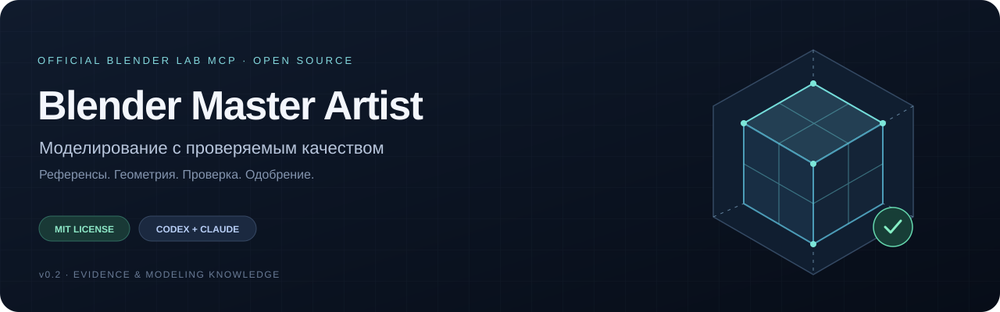
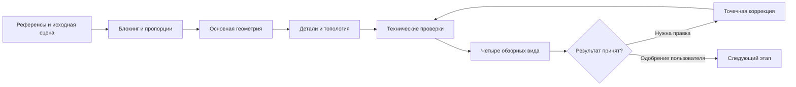

<p align="center">
  
</p>

<p align="center">
  <strong>Открытый набор навыков и инструментов для AI-моделирования через официальный Blender Lab MCP</strong>
</p>

<p align="center">
  <a href="README.en.md">English</a> ·
  <a href="#быстрый-старт">Быстрый старт</a> ·
  <a href="#что-уже-работает">Возможности</a> ·
  <a href="#демонстрация">Демонстрация</a> ·
  <a href="docs/verification.md">Проверки</a> ·
  <a href="LICENSE">MIT</a>
</p>

---

**Blender Master Artist (BMA)** помогает агенту исследовать сцену, сохранить исходную
геометрию, построить модель, обнаружить технические дефекты и представить результат
для одобрения. В основе — переносимый Agent Skill, работающий Python-код и проверяемые
артефакты: отчёты, контрольные `.blend` и обзорные изображения.

**Статус: v0.1 · экспериментальная основа.** Первый выполненный сценарий — моделирование
корпуса прибора. Проект не обещает безошибочную реконструкцию любого объекта или
автоматическую готовность модели к производству.

## Что уже работает

| Задача | Что делает BMA |
| :--- | :--- |
| **Изучить сцену** | Инвентаризация объектов, коллекций, материалов, модификаторов и зависимостей |
| **Проверить сетку** | Исходная и вычисленная геометрия, вырожденные грани, незамкнутые и неманифолдные рёбра, дубликаты, свободные элементы, согласованность обхода граней |
| **Контролировать параметры** | Размеры, bounding box, плотность, число треугольников, трансформации и наличие UV |
| **Сохранить работу** | Версионные контрольные файлы и контрольные суммы, без применения модификаторов во время проверки |
| **Проверить внешний вид** | Четыре нейтральных вида: спереди, сбоку, сверху и в перспективе; просмотр фиксируется отдельно от рендера |
| **Управлять этапами** | Явное одобрение, разрешения на конкретные правки и отклонение устаревших доказательств |
| **Подключить агента** | Адаптер официального Blender Lab MCP с проверкой реально доступных команд |
| **Сохранить опыт** | Технические записи со статусом, областью применимости, доказательствами и ограничениями |

Валидаторы работают **без исправления сетки**. Отчёт о проблеме не является разрешением
удалить вершины, перестроить объект или применить модификатор.

## Как устроен процесс



Приоритет моделирования:

**Силуэт → пропорции → основные формы → вторичные формы → функциональные детали →
топология → материалы → подача.**

Техническое прохождение проверок, визуальный просмотр, одобрение пользователя и
успешный экспорт — отдельные результаты. Правки одобренной геометрии требуют
разрешения в соответствующей области. Повторные коррекции ограничены числом попыток.

## Быстрый старт

Для базовой части нужен **Python 3.10+**, сторонние библиотеки не требуются.
Целевая среда Blender — **5.1+**; локально проверены Blender **5.3.0** и внешний
Python **3.12**. Другие версии пока не прошли такую же проверку.

```sh
python -m unittest discover -s tests -v
python -m bma validate-snapshot examples/cube.json --output outputs/cube-report.json
python scripts/privacy_audit.py .
```

При необходимости установите Python-пакет и клиент MCP:

```sh
python -m pip install -e ".[mcp]"
```

`bpy`, `bmesh` и `mathutils` предоставляет Python внутри Blender. Отдельная установка
`bpy` в обычный интерпретатор для работы с этим проектом не требуется.

### Подключение к агенту

Для обнаружения skill в проекте Codex:

```sh
python scripts/install_skill.py --destination .agents/skills/blender-master-artist
```

Для Claude Code укажите `.claude/skills/blender-master-artist`. Установщик копирует
подготовленные файлы и отказывается перезаписывать существующую папку.

| Руководство | Содержание |
| :--- | :--- |
| [Установка](docs/installation.md) | Требования, официальный add-on и запуск сервера |
| [Codex](integrations/codex/README.md) | Обнаружение skill и регистрация MCP |
| [Claude Code](integrations/claude/README.md) | Установка того же skill для Claude |
| [Адаптер Blender Lab MCP](integrations/blender-mcp/README.md) | API и разрешения на правки |

Используется **[официальный Blender Lab MCP](https://www.blender.org/lab/mcp-server/)**.
Сервер и add-on не включены в BMA; их установка и изменение конфигурации не выполняются
автоматически. Сравнение интеграций и лицензий — в [исследовании](docs/research.md).

### Пример запроса

> Используй Blender Master Artist и официальный Blender Lab MCP. Изучи текущую сцену
> и сохрани существующую геометрию. Подготовь корпус прибора со съёмной крышкой:
> установи размеры и систему координат, сохрани контрольную версию и представь
> этап исследования для одобрения перед моделированием.

## Демонстрация

Первый пример — **оригинальный корпус прибора** с отдельной крышкой и передней панелью.
Размеры заданы как синтетическая проектная спецификация:

| Параметр | Значение |
| :--- | ---: |
| Ширина × глубина корпуса | 240 × 160 мм |
| Высота корпуса | 72 мм |
| Толщина стенок | 4 мм |
| Толщина крышки / зазор | 6 мм / 1 мм |

Воспроизведение в **отдельном процессе Blender с заводской сценой**:

```sh
blender --background --factory-startup --python-exit-code 1 --python scripts/blender_demo.py -- --output outputs/demo
```

Используйте пустую выходную папку. Скрипт создаёт следующие реальные результаты:

1. Блокинг и первую контрольную версию.
2. Полый корпус, отдельную крышку, панель и неприменённые bevel-модификаторы.
3. Намеренно внесённые дефекты: вырожденный треугольник, совпадающие и свободные элементы.
4. JSON-отчёт, обнаруживающий эти дефекты.
5. Точечное удаление известных добавленных дефектов с сохранением остальных компонентов.
6. Финальный отчёт, четыре обзорных вида и сохранённый `.blend`.

Это воспроизводимый тест качества. Исправление известных внедрённых дефектов не
означает, что система умеет автоматически чинить произвольную модель. Новый запуск
оставляет визуальный просмотр и пользовательское одобрение ожидающими.

## Что проверено

| Проверка | Локальный результат |
| :--- | :--- |
| Модульные тесты | **36 пройдено** |
| Интеграционные тесты внутри Blender | **14 пройдено** |
| Реальный вызов официального MCP | Инвентаризация, создание, bevel, валидация, рендер и сохранение |
| Повторное открытие итогового `.blend` | Технические проверки пройдены |
| Сборка Python-пакета | Wheel и архив исходников собраны; CLI из wheel проверен |
| Приватность | Исходники и собранные пакеты проверены по известным признакам утечек |

Это результаты локального запуска, не сравнение AI-моделей и не утверждение об
успешном запуске GitHub Actions. Версии, методика и границы проверки описаны в
[verification](docs/verification.md), команды — в [testing](docs/testing.md).

## Границы v0.1

- Автоматическая художественная оценка и универсальная реконструкция по фотографии не реализованы.
- Технический отчёт не доказывает отсутствие самопересечений, правильность направленных наружу нормалей или полезность edge flow.
- Наличие UV не подтверждает качество развёртки, упаковки или отсутствие перекрытий.
- Деформации персонажей, производственная пригодность и экспорт в конкретный движок требуют отдельных испытаний.
- Остальные предметные области представлены инструкциями; полностью выполненный сценарий этой версии — hard surface.
- Журнал одобрений не является системой аутентификации или песочницей для произвольного Python.

## Структура проекта

```text
SKILL.md       Входная точка для агента
bma/           Валидаторы, этапы, MCP-адаптер и демонстрация
skills/        Инструкции по предметным областям
knowledge/     Топология, принципы, ошибки и политика знаний
workflows/     Новая модель, существующий проект, референсы, коррекции
integrations/  Codex, Claude Code и официальный Blender Lab MCP
tests/         Модульные и реальные Blender-тесты
docs/          Архитектура, установка, исследования и приватность
```

Подробности: [архитектура](docs/architecture.md) · [этапы и одобрения](docs/stages.md) ·
[валидаторы](validators/README.md) · [пример защищённой правки](examples/guarded_edit.py).

## Приватность, лицензия и участие

Рабочие `.blend`, логи, пользовательские референсы и результаты запусков хранятся
в игнорируемых папках. В репозиторий не должны попадать личные данные, переписки,
ключи доступа или закрытые модели. Перед публикацией запускайте
[аудит приватности](docs/privacy.md); автоматическая проверка не заменяет ручной просмотр.

Код BMA и оригинальные примеры распространяются по **[MIT](LICENSE)**. Blender Lab MCP
и его add-on сохраняют свои условия **GPL-3.0-or-later** и не поставляются в этом проекте.
Обложка — оригинальная схема рабочего процесса, а не рендер демонстрационной модели.

[Как участвовать](CONTRIBUTING.md) · [Безопасность](SECURITY.md) · [English README](README.en.md)
